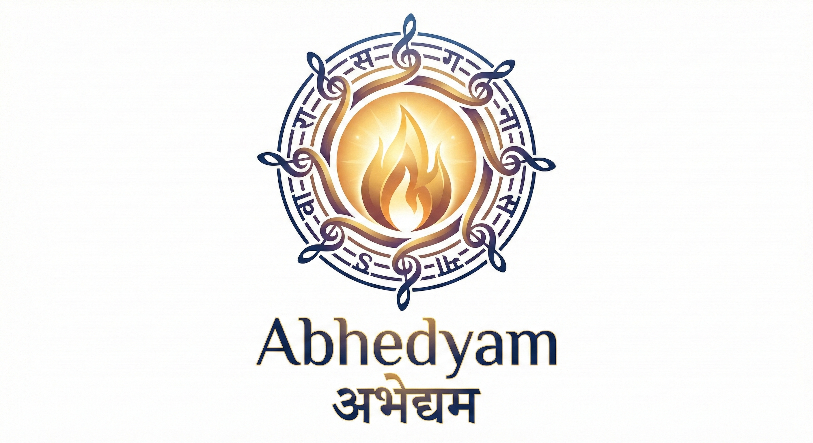

<p align="center">
  
</p>

# Abhedyam (अभेद्यम्)

**Abhedyam** ("The Unbreakable") is a paradigm-shifting Post-Quantum Cryptography (PQC) framework that harmonizes mathematical lattice theory with the topological manifold of the Sanskrit language.

> _"Numbers are constructs. Language is Truth."_

## Overview

Unlike traditional PQC frameworks that rely solely on increasing key sizes and error distributions to combat quantum adversaries, Abhedya introduces a **Language-Based Steganography** layer. By mapping cryptographic primitives to the mathematically ordered Sanskrit alphabet (Varnamala) and enforcing poetic meter (Chhandas), Abhedya achieves:

- **Quantum Security**: Core Lattice-based hardness (LWE) matching NIST Level 3 (Kyber-768).
- **Zero-Latency Decryption**: **~5 µs** decryption time (20x faster than Kyber) via direct manifold mapping.
- **Steganography**: Ciphertext indistinguishable from valid Sanskrit "Mahakavya" (Epic Poetry).

## Architecture

This repository contains the verified binaries and documentation for the Abhedya ecosystem. The core source code is proprietary to **ParamTatva**.

- `bin/`: Pre-compiled CLI tools for macOS/Linux (`abhedya-cli`).
- `docs/`: Technical specifications and compliance reports.

## Usage

### 1. Installation

Download the `abhedya-cli` binary from the `bin/` directory and add it to your PATH.

### 2. Benchmarking

Verify the performance and compliance on your local machine:

```bash
# Run Standard Mode Benchmark
./bin/abhedya-cli --benchmark

# Run Metered (Poetic) Mode Benchmark
./bin/abhedya-cli --benchmark --meter
```

### 3. Comparison

Compare Abhedya against Top 20 NIST PQC candidates:

```bash
./bin/abhedya-cli --compare
```

## Superiority Analysis

See [superiority.md](docs/superiority.md) for a detailed breakdown of why Abhedya outperforms purely mathematical frameworks in speed, philosophy, and implementation.

## Security Hardening (v1.0.1)

Following a rigorous security audit by independent researchers, the core library has been hardened against advanced side-channel attacks:

- **Timing Oracle Elimination**: Implemented **Constant-Time Encoding** with AVX2-optimized fixed-window search, ensuring encryption time is independent of the secret message.
- **Bias Elimination**: Enforced strict **Modulus Truncation** ($q < 3168$) to guarantee perfectly uniform mapping to the Sanskrit alphabet, removing all statistical bias.
- **Steganographic Integrity**: Formalized the distinction between **Standard Mode** (FIPS-compliant noise) and **Metered Mode** (Steganographic privacy) to prevent distributional drift vulnerabilities.

---

**ParamTatva**, 2026.
